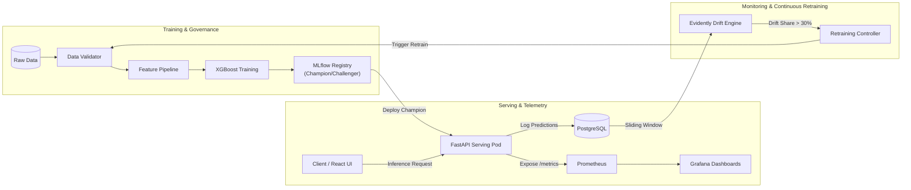

# Enterprise MLOps Platform – End-to-End Machine Learning Lifecycle Management

[](https://github.com/rachamalla-akshara/Enterprise-MLOps-Platform)
[](https://python.org)
[](https://fastapi.tiangolo.com)
[](https://mlflow.org)
[](https://docker.com)
[](https://kubernetes.io)
[](https://prometheus.io)
[](https://grafana.com)
[](https://evidentlyai.com)

---

## 1. Project Overview

The **Enterprise MLOps Platform** is an industry-grade, production-hardened Machine Learning lifecycle management platform. It solves the critical operational challenge of deploying, managing, and maintaining machine learning models reliably at scale.

Rather than treating machine learning as static model training, this platform implements a fully automated, closed-loop MLOps architecture:
- **Reproducible Experimentation**: Automated data validation, pipeline transformations, and hyperparameter tuning tracked in MLflow.
- **Model Governance**: Formal Champion/Challenger model registry lifecycle with automated gating gates.
- **Production Serving**: High-performance, asynchronous FastAPI inference engine instrumented with Prometheus telemetry.
- **Inference Persistence**: Real-time logging of prediction payloads, probabilities, and ground-truth feedback into PostgreSQL.
- **Continuous Monitoring & Drift Detection**: Automated statistical data drift and concept drift detection using Evidently AI (Kolmogorov-Smirnov & Chi-Square tests).
- **Automated Retraining Loop**: Event-driven and scheduled retraining triggered upon verified data distribution divergence.
- **Enterprise Deployment**: Multi-stage Docker containers, Docker Compose orchestration for local development, and Kubernetes manifests with Horizontal Pod Autoscaling (HPA) and zero-downtime rolling updates.

---

## 2. Initial ML Use Case: Customer Churn Prediction

The reference implementation targets **Customer Churn Prediction** using an enterprise telecommunications subscription dataset:
- **Task**: Supervised binary classification ($\hat{y} \in \{0, 1\}$).
- **Business Goal**: Identify high-risk churn customers in advance, enabling proactive retention campaigns and minimizing customer lifetime revenue loss.
- **Target Metric Priorities**: PR-AUC and Recall (prioritizing detection of churners given class imbalance where churn rate is $\sim 26\%$), coupled with expected financial cost minimization.
- **Champion Estimator**: Tuned gradient-boosted decision trees (`XGBoost`) encapsulated inside a Scikit-learn `Pipeline` and `ColumnTransformer` guaranteeing zero data leakage.

---

## 3. Technology Stack

| Domain | Technology | Purpose |
| :--- | :--- | :--- |
| **Language & Core** | Python 3.11 | Core runtime for pipelines, APIs, and background daemons |
| **Machine Learning** | Scikit-learn, XGBoost, Optuna | Feature pipelines, baselines, champion model, and HPO |
| **Experiment Tracking** | MLflow | Run tracking, parameter/metric logging, and model registry |
| **Model Serving** | FastAPI, Uvicorn, Pydantic | High-throughput asynchronous REST API for single and batch inference |
| **Database** | PostgreSQL 15 | Structured telemetry: prediction logs, feedback, and drift audits |
| **Object Storage** | MinIO / AWS S3 | Artifact store for MLflow serialized models and Evidently HTML reports |
| **Model Monitoring** | Evidently AI | Non-parametric statistical data and target drift detection |
| **Metrics & Alerts** | Prometheus | System and ML runtime time-series scraping and alerting |
| **Dashboards** | Grafana | Production dashboards for system performance and ML drift telemetry |
| **Containerization** | Docker, Docker Compose | Immutable multi-stage container builds and local stack orchestration |
| **Orchestration** | Kubernetes (k8s) | Declarative deployments, services, ingress, HPA, and health probes |
| **Frontend UI** | React, TypeScript | Operations portal for model evaluation, inference playground, and drift review |
| **CI/CD** | GitHub Actions | Automated linting, testing, security audits, container build, and deployment |

---

## 4. Architectural Overview



---

## 5. Repository Documentation Guide

Complete architectural blueprints and operational specifications are available in the [`docs/`](file:///C:/Users/raksh/.gemini/antigravity/scratch/Enterprise-MLOps-Platform/docs) directory:

- [**System Architecture & Database Schema (`docs/architecture.md`)**](file:///C:/Users/raksh/.gemini/antigravity/scratch/Enterprise-MLOps-Platform/docs/architecture.md): Complete component architecture, repository structure, security design, and PostgreSQL DDL schema.
- [**ML Pipeline & Model Governance (`docs/ml_pipeline.md`)**](file:///C:/Users/raksh/.gemini/antigravity/scratch/Enterprise-MLOps-Platform/docs/ml_pipeline.md): Data ingestion, feature transformations, candidate models, evaluation metrics, and acceptance gates.
- [**MLflow Tracking & Registry Design (`docs/mlflow_design.md`)**](file:///C:/Users/raksh/.gemini/antigravity/scratch/Enterprise-MLOps-Platform/docs/mlflow_design.md): Experiment organization, run metadata schema, model signatures, and promotion policies.
- [**Deployment Architecture (`docs/deployment_design.md`)**](file:///C:/Users/raksh/.gemini/antigravity/scratch/Enterprise-MLOps-Platform/docs/deployment_design.md): Multi-stage Dockerfiles, Docker Compose topology, Kubernetes manifests, HPA, and rolling update strategies.
- [**Monitoring & Drift Detection (`docs/monitoring_design.md`)**](file:///C:/Users/raksh/.gemini/antigravity/scratch/Enterprise-MLOps-Platform/docs/monitoring_design.md): Prometheus metrics catalog, Grafana dashboards, Evidently AI statistical tests, and automated retraining triggers.
- [**Implementation Roadmap & Testing (`docs/implementation_roadmap.md`)**](file:///C:/Users/raksh/.gemini/antigravity/scratch/Enterprise-MLOps-Platform/docs/implementation_roadmap.md): Multi-phase development roadmap, unit/integration/stress testing strategy, and GitHub Actions CI/CD workflows.

---

## 6. Phased Implementation Status

```text
[x] Phase 0: System Architecture, Database Schemas, Design Specs & Environment Setup
[ ] Phase 1: Core ML Pipeline, Preprocessing, Model Training & Evaluation Engine
[ ] Phase 2: MLflow Tracking Server Infrastructure & Model Registry Lifecycle
[ ] Phase 3: Production-Grade FastAPI Model Serving Engine & Prediction Logging
[ ] Phase 4: Docker Multi-Stage Containerization & Local Compose Orchestration
[ ] Phase 5: Evidently AI Drift Detection Worker & Automated Retraining Loop
[ ] Phase 6: Prometheus & Grafana Observability Dashboards & Alert Rules
[ ] Phase 7: Kubernetes Orchestration (Manifests, HPA, Ingress & Health Probes)
[ ] Phase 8: GitHub Actions CI/CD Automation & Security Scanning
[ ] Phase 9: React Operations Dashboard & Inference Playground
```

---

## 7. Environment Configuration Quickstart

1. Clone repository and initialize environment template:
   ```bash
   cp .env.example .env
   ```
2. Review and configure runtime settings in `.env` (PostgreSQL credentials, MLflow URIs, API keys, and drift thresholds).
3. Follow the phase-by-phase rollout guide in [`docs/implementation_roadmap.md`](file:///C:/Users/raksh/.gemini/antigravity/scratch/Enterprise-MLOps-Platform/docs/implementation_roadmap.md).
