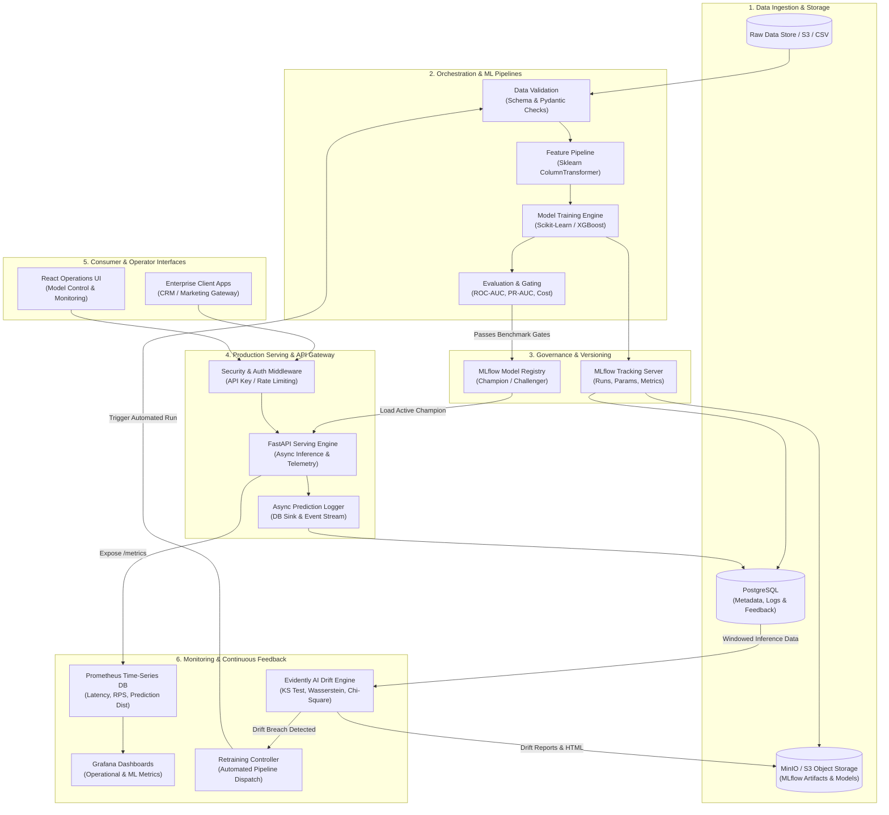
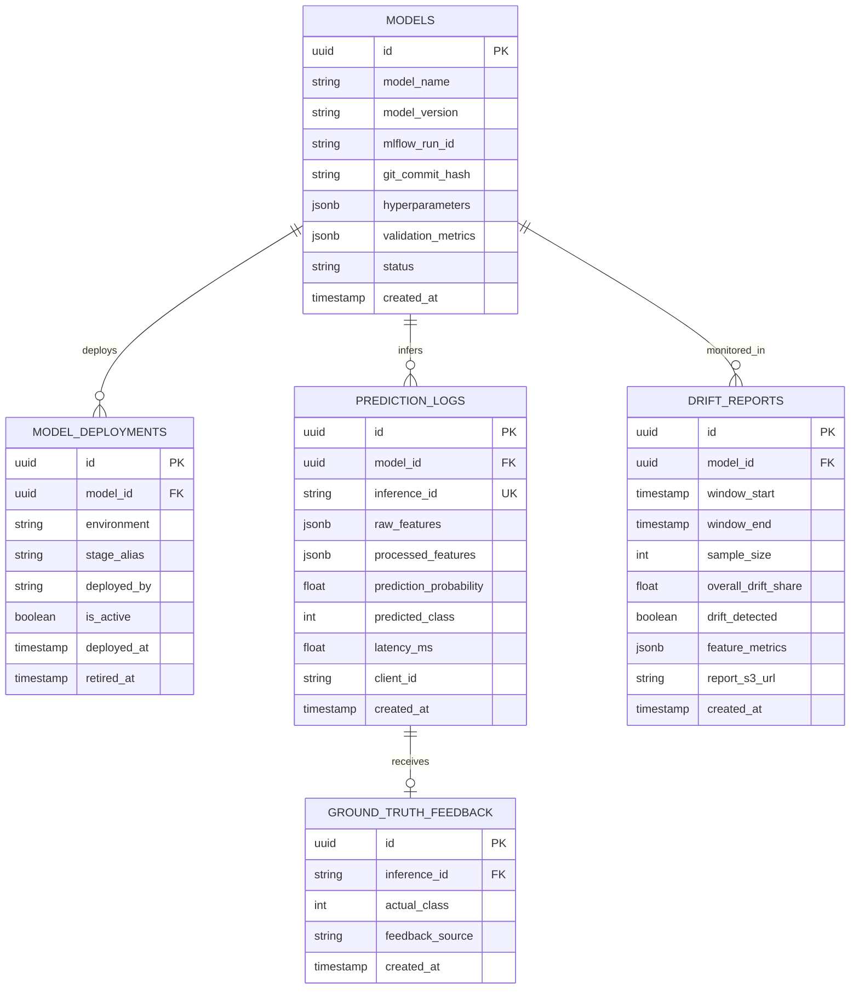

# Enterprise MLOps Platform - System Architecture Specification

## 1. Executive Summary & Vision

The **Enterprise MLOps Platform** is an enterprise-grade, end-to-end Machine Learning lifecycle system built to bridge the gap between experimental data science and mission-critical production operations. The platform standardizes model training, experiment tracking, artifact versioning, automated gating, high-throughput containerized serving, real-time telemetry, automated drift detection, and continuous retraining.

The reference implementation targets **Customer Churn Prediction** in a subscription business context, addressing high-impact business needs: real-time churn risk scoring, automated customer retention interventions, feature drift alerting, and automated model re-calibration without service interruption.

---

## 2. High-Level System Architecture



---

## 3. Detailed Repository Layout

The repository follows a clean, modular, domain-driven structure decoupling the ML pipeline core, API services, monitoring daemons, database layers, and deployment assets:

```text
Enterprise-MLOps-Platform/
├── .github/
│   └── workflows/
│       ├── ci.yml                     # Unit tests, linting, type checks, security audit
│       ├── model_pipeline.yml         # Scheduled or event-driven model training & evaluation
│       └── cd.yml                     # Container build, security scan, Kubernetes deployment
├── configs/
│   ├── config.yaml                    # Master application & pipeline settings
│   ├── model_params.yaml              # Hyperparameter grids (XGBoost, RandomForest, LogReg)
│   ├── feature_schema.yaml            # Expected raw & processed feature definitions
│   └── drift_rules.yaml               # Evidently AI drift thresholds and statistical test rules
├── data/
│   ├── raw/                           # Raw immutable datasets (.gitkeep)
│   ├── processed/                     # Train/validation/test processed sets (.gitkeep)
│   ├── samples/                       # Test payloads for integration and API testing
│   └── reference/                     # Baseline production reference distribution for drift
├── docs/
│   ├── architecture.md                # System architecture, schemas, and diagrams
│   ├── ml_pipeline.md                 # End-to-end data and modeling pipeline specification
│   ├── mlflow_design.md               # Tracking server, experiments, and registry lifecycle
│   ├── deployment_design.md           # Docker, Compose, and Kubernetes orchestration
│   ├── monitoring_design.md           # Prometheus, Grafana, and Evidently drift mechanics
│   └── implementation_roadmap.md      # Phased execution plan and milestones
├── docker/
│   ├── Dockerfile.api                 # Optimized multi-stage build for FastAPI inference engine
│   ├── Dockerfile.mlflow              # MLflow tracking server container
│   ├── Dockerfile.evidently           # Background drift worker container
│   ├── Dockerfile.frontend            # Nginx + React static build
│   └── docker-compose.yml             # Full local enterprise stack orchestration
├── k8s/
│   ├── base/
│   │   ├── namespace.yaml             # mlops-platform namespace definition
│   │   ├── configmap.yaml             # Non-sensitive runtime variables
│   │   ├── secrets.yaml.template      # Production secret definitions
│   │   ├── api-deployment.yaml        # FastAPI replicas with HPA and probes
│   │   ├── api-service.yaml           # ClusterIP / Ingress configuration
│   │   ├── mlflow-deployment.yaml     # MLflow tracking service
│   │   └── postgres-statefulset.yaml  # StatefulSet with PersistentVolumeClaims
│   └── overlays/
│       ├── dev/
│       └── prod/
├── monitoring/
│   ├── prometheus/
│   │   ├── prometheus.yml             # Scraping configurations & scrape interval
│   │   └── alert_rules.yml            # System latency, error rate & drift alerts
│   └── grafana/
│       ├── provisioning/
│       │   ├── datasources/           # Auto-configured Prometheus & Postgres connections
│       │   └── dashboards/            # Provisioning manifests
│       └── dashboards/
│           ├── operational_health.json# API latency, throughput, error rates
│           └── ml_model_telemetry.json# Prediction distribution, churn rate, feature stats
├── scripts/
│   ├── setup_local_env.sh             # Virtual environment and pre-commit setup
│   ├── seed_database.py               # Database schema initialization and seed data
│   └── run_drift_check.py             # CLI entrypoint to execute drift audit
├── src/
│   ├── __init__.py
│   ├── common/
│   │   ├── __init__.py
│   │   ├── config.py                  # Pydantic BaseSettings management
│   │   ├── logger.py                  # Structured JSON logging formatter
│   │   └── exceptions.py              # Platform-wide custom exception hierarchy
│   ├── database/
│   │   ├── __init__.py
│   │   ├── connection.py              # SQLAlchemy asynchronous engine & session pool
│   │   ├── models.py                  # ORM models (Predictions, Feedback, DriftLogs, Audits)
│   │   └── repositories.py            # Data access layer for telemetry and inference records
│   ├── data/
│   │   ├── __init__.py
│   │   ├── loader.py                  # Data loading and stratified partitioning
│   │   ├── validator.py               # Input data schema validation via Pydantic
│   │   └── preprocessor.py            # Scikit-learn Pipeline / ColumnTransformer definitions
│   ├── models/
│   │   ├── __init__.py
│   │   ├── base.py                    # Abstract base model interface
│   │   ├── churn_model.py             # XGBoost & Scikit-learn model wrapper implementations
│   │   ├── train.py                   # Full training workflow orchestrator
│   │   ├── evaluate.py                # Performance metric evaluation & threshold checking
│   │   └── registry.py                # MLflow client integration & lifecycle promotions
│   ├── serving/
│   │   ├── __init__.py
│   │   ├── main.py                    # FastAPI application initialization & middleware
│   │   ├── schemas.py                 # Pydantic request & response schemas
│   │   ├── dependencies.py            # Model loader, DB session, & security dependencies
│   │   ├── telemetry.py               # Prometheus metrics definitions & collectors
│   │   └── routers/
│   │       ├── health.py              # Liveness, readiness, and dependency health checks
│   │       ├── inference.py           # Real-time single & batch prediction endpoints
│   │       ├── feedback.py            # Ground-truth label ingestion for performance tracking
│   │       └── control.py             # Model reloading and admin controls
│   └── monitoring/
│       ├── __init__.py
│       ├── drift_detector.py          # Evidently AI DataDrift & TargetDrift calculation
│       ├── report_generator.py        # HTML & JSON report generation to storage
│       └── retrain_controller.py      # Automated retraining logic & webhook dispatcher
├── tests/
│   ├── conftest.py                    # Pytest fixtures (sample data, mock MLflow, mock DB)
│   ├── unit/
│   │   ├── test_data_validation.py    # Schema integrity and edge cases
│   │   ├── test_preprocessing.py      # Zero data leakage, transformer fits
│   │   └── test_model_training.py     # Training determinism and metric computation
│   ├── integration/
│   │   ├── test_api_endpoints.py      # FastAPI inference with active model
│   │   ├── test_database_logging.py   # Async telemetry persistence
│   │   └── test_drift_pipeline.py     # Drift calculation execution
│   └── e2e/
│       └── test_full_lifecycle.py     # Train -> Register -> Serve -> Monitor -> Retrain
├── .env.example                       # Canonical environment template
├── .gitignore                         # Comprehensive ignore specification
├── pyproject.toml                     # Python packaging and dependency definitions
├── requirements.txt                   # Production pinned dependencies
├── requirements-dev.txt               # Testing and linting dependencies
└── README.md                          # Repository guide and operations documentation
```

---

## 4. Production Database Schema Design

The operational database uses **PostgreSQL** to record runtime predictions, real-time ground-truth feedback, data drift analysis audits, and model governance change-logs.

### Entity-Relationship Diagram



### PostgreSQL DDL Specification

```sql
-- Schema: mlops_platform
CREATE SCHEMA IF NOT EXISTS mlops_platform;

-- Table 1: Model Registration & Lineage Record
CREATE TABLE mlops_platform.models (
    id UUID PRIMARY KEY DEFAULT gen_random_uuid(),
    model_name VARCHAR(100) NOT NULL,
    model_version VARCHAR(50) NOT NULL,
    mlflow_run_id VARCHAR(100) NOT NULL,
    git_commit_hash VARCHAR(40),
    hyperparameters JSONB NOT NULL DEFAULT '{}'::jsonb,
    validation_metrics JSONB NOT NULL DEFAULT '{}'::jsonb,
    status VARCHAR(30) NOT NULL DEFAULT 'REGISTERED',
    created_at TIMESTAMP WITH TIME ZONE DEFAULT CURRENT_TIMESTAMP,
    CONSTRAINT uq_model_name_version UNIQUE (model_name, model_version)
);

-- Table 2: Model Deployment History & Status
CREATE TABLE mlops_platform.model_deployments (
    id UUID PRIMARY KEY DEFAULT gen_random_uuid(),
    model_id UUID NOT NULL REFERENCES mlops_platform.models(id) ON DELETE CASCADE,
    environment VARCHAR(30) NOT NULL,
    stage_alias VARCHAR(30) NOT NULL, -- e.g. 'champion', 'challenger'
    deployed_by VARCHAR(100) NOT NULL,
    is_active BOOLEAN NOT NULL DEFAULT TRUE,
    deployed_at TIMESTAMP WITH TIME ZONE DEFAULT CURRENT_TIMESTAMP,
    retired_at TIMESTAMP WITH TIME ZONE
);

CREATE INDEX idx_deployments_active ON mlops_platform.model_deployments(stage_alias, is_active);

-- Table 3: Prediction Logs (High-Volume Ingestion)
CREATE TABLE mlops_platform.prediction_logs (
    id UUID PRIMARY KEY DEFAULT gen_random_uuid(),
    model_id UUID NOT NULL REFERENCES mlops_platform.models(id),
    inference_id VARCHAR(64) NOT NULL UNIQUE,
    raw_features JSONB NOT NULL,
    prediction_probability NUMERIC(6, 5) NOT NULL,
    predicted_class SMALLINT NOT NULL,
    latency_ms NUMERIC(8, 2) NOT NULL,
    client_id VARCHAR(100) DEFAULT 'anonymous',
    created_at TIMESTAMP WITH TIME ZONE DEFAULT CURRENT_TIMESTAMP
);

CREATE INDEX idx_predictions_created_at ON mlops_platform.prediction_logs(created_at);
CREATE INDEX idx_predictions_model_id ON mlops_platform.prediction_logs(model_id);

-- Table 4: Ground Truth Feedback (Asynchronous Label Ingestion)
CREATE TABLE mlops_platform.ground_truth_feedback (
    id UUID PRIMARY KEY DEFAULT gen_random_uuid(),
    inference_id VARCHAR(64) NOT NULL REFERENCES mlops_platform.prediction_logs(inference_id) ON DELETE CASCADE,
    actual_class SMALLINT NOT NULL,
    feedback_source VARCHAR(100) DEFAULT 'crm_sync',
    created_at TIMESTAMP WITH TIME ZONE DEFAULT CURRENT_TIMESTAMP
);

CREATE INDEX idx_feedback_inference_id ON mlops_platform.ground_truth_feedback(inference_id);

-- Table 5: Data Drift Analysis Audit
CREATE TABLE mlops_platform.drift_reports (
    id UUID PRIMARY KEY DEFAULT gen_random_uuid(),
    model_id UUID NOT NULL REFERENCES mlops_platform.models(id),
    window_start TIMESTAMP WITH TIME ZONE NOT NULL,
    window_end TIMESTAMP WITH TIME ZONE NOT NULL,
    sample_size INT NOT NULL,
    overall_drift_share NUMERIC(5, 4) NOT NULL,
    drift_detected BOOLEAN NOT NULL,
    feature_metrics JSONB NOT NULL,
    report_s3_url TEXT,
    created_at TIMESTAMP WITH TIME ZONE DEFAULT CURRENT_TIMESTAMP
);

CREATE INDEX idx_drift_reports_created ON mlops_platform.drift_reports(created_at);
```

---

## 5. Security & Isolation Architecture

1. **API Security**:
   - Ingress endpoints enforce API Key validation via `X-API-Key` headers or OAuth2 Bearer Tokens.
   - Pydantic models validate and sanitize all payload structures, preventing injection attacks.
   - Rate limiting per client token to protect against denial-of-service surges.

2. **Container Security**:
   - Multi-stage Docker builds discard build tools, compilers, and caches.
   - All runtime images run as non-root users (`UID 10001`).
   - Root filesystems mount read-only where possible; dynamic temp data is restricted to ephemeral volume mounts.

3. **Secrets Management**:
   - Zero hardcoded secrets in codebase or Docker images.
   - Configuration via strictly typed Pydantic `BaseSettings` reading environment variables.
   - In Kubernetes, sensitive variables are mounted from native Kubernetes `Secrets` or HashiCorp Vault.

4. **Network Policies**:
   - Database and MinIO ports are kept internal to the container network and never exposed directly to public ingress.
   - FastAPI sits behind a reverse proxy (Nginx or Kubernetes Ingress Controller) terminating TLS.
