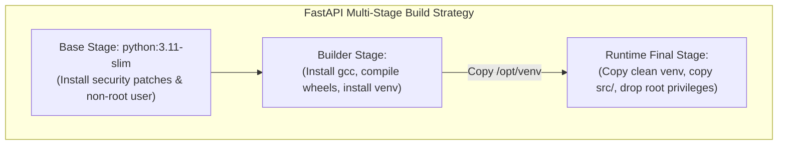
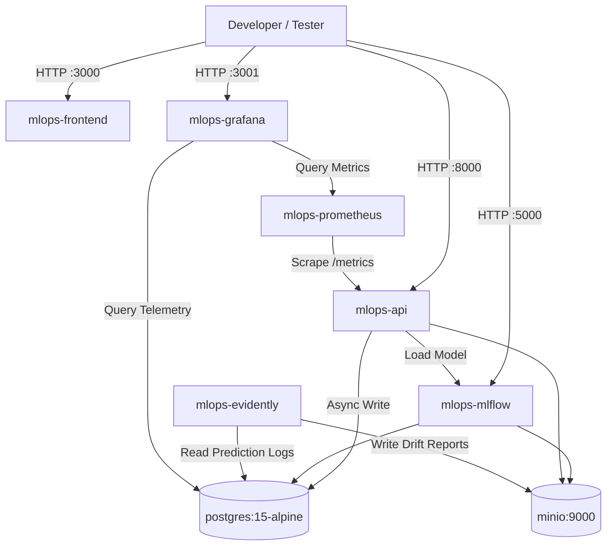
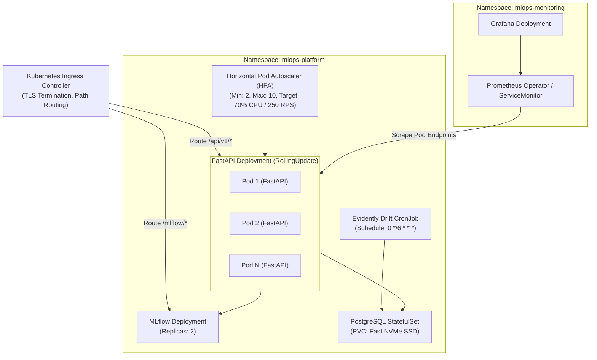

# Docker & Kubernetes Deployment Architecture

## 1. Containerization Architecture (Docker)

All platform components are packaged into immutable, self-contained Docker images adhering to the CIS Docker Benchmark:
- Multi-stage builds to strip build toolchains (`gcc`, `g++`, header files).
- Explicit non-root service accounts (`UID 10001:GID 10001`).
- Minimal base images (`python:3.11-slim` and `node:20-alpine`).
- Deterministic pinned dependencies.



### Container Suite Breakdown

| Container Image | Base Image | Role | Exposure / Port |
| :--- | :--- | :--- | :--- |
| `mlops-api` | `python:3.11-slim` | FastAPI inference engine & metrics | Internal 8000 |
| `mlops-mlflow` | `python:3.11-slim` | MLflow tracking server | Internal 5000 |
| `mlops-evidently` | `python:3.11-slim` | Scheduled drift calculation worker | Internal daemon |
| `mlops-frontend` | `nginx:alpine` | Static React single-page app | Port 80 / 3000 |
| `postgres` | `postgres:15-alpine` | Telemetry, feedback, MLflow metadata | Port 5432 |
| `minio` | `minio/minio:RELEASE...` | S3-compatible model artifact store | Port 9000 (API), 9001 (Console) |
| `prometheus` | `prom/prometheus:v2.48.0` | Metrics scraper and time-series store | Port 9090 |
| `grafana` | `grafana/grafana:10.2.0` | Dashboards for latency, drift, performance | Port 3001 |

---

## 2. Local Docker Compose Architecture

For local developer workstation evaluation and continuous integration testing, `docker/docker-compose.yml` orchestrates the complete topology with automated health dependencies:



### Compose Service Ordering & Healthchecks
- `postgres` initializes first with a `pg_isready` healthcheck.
- `minio` initializes and executes a sidecar `minio/mc` command to ensure the `mlops-artifacts` bucket exists.
- `mlflow` waits for `postgres` and `minio` to be healthy before starting tracking migrations.
- `api` waits for `mlflow` and `postgres` before loading the current production champion.

---

## 3. Kubernetes Deployment Architecture (Production)

In production, the platform runs in a Kubernetes cluster partitioned into logical namespaces: `mlops-platform` (business and serving layer) and `mlops-monitoring` (telemetry and observability).



---

## 4. Kubernetes Workload Specifications

### 1. Zero-Downtime Rolling Updates
```yaml
strategy:
  type: RollingUpdate
  rollingUpdate:
    maxSurge: 25%
    maxUnavailable: 0
```
Guarantees uninterrupted inference traffic during model updates or application upgrades.

### 2. Comprehensive Probe Configuration
- **Startup Probe (`/health/startup`)**:
  Allows up to 60 seconds for the container to download and deserialize the XGBoost model pipeline from MLflow/MinIO before kubelet triggers restarts:
  ```yaml
  startupProbe:
    httpGet:
      path: /api/v1/health/startup
      port: 8000
    failureThreshold: 12
    periodSeconds: 5
  ```
- **Readiness Probe (`/health/ready`)**:
  Validates that the model pipeline is in memory and PostgreSQL connection pool is active:
  ```yaml
  readinessProbe:
    httpGet:
      path: /api/v1/health/ready
      port: 8000
    periodSeconds: 10
    timeoutSeconds: 2
  ```
- **Liveness Probe (`/health/live`)**:
  Lightweight event loop heartbeat:
  ```yaml
  livenessProbe:
    httpGet:
      path: /api/v1/health/live
      port: 8000
    periodSeconds: 15
    timeoutSeconds: 2
  ```

### 3. Resource Requests & Limits
```yaml
resources:
  requests:
    cpu: "500m"
    memory: "512Mi"
  limits:
    cpu: "2000m"
    memory: "2Gi"
```

### 4. Horizontal Pod Autoscaler (HPA)
Autoscales from 2 to 10 pods when average pod CPU exceeds 70% or when custom metrics (Prometheus Adapter) report request latency $> 50\text{ ms}$.

### 5. Canary Model Rollout Strategy
When promoting a Challenger model to Champion:
1. A secondary Deployment (`api-challenger`) is spun up with 1 replica.
2. Ingress traffic is weighted: 90% Champion, 10% Challenger.
3. Prometheus monitors error rates and latency on the Challenger.
4. If the Challenger maintains 0% error rate and meeting SLA for 60 minutes, Ingress traffic shifts to 100%, and the Challenger is promoted to Champion.
