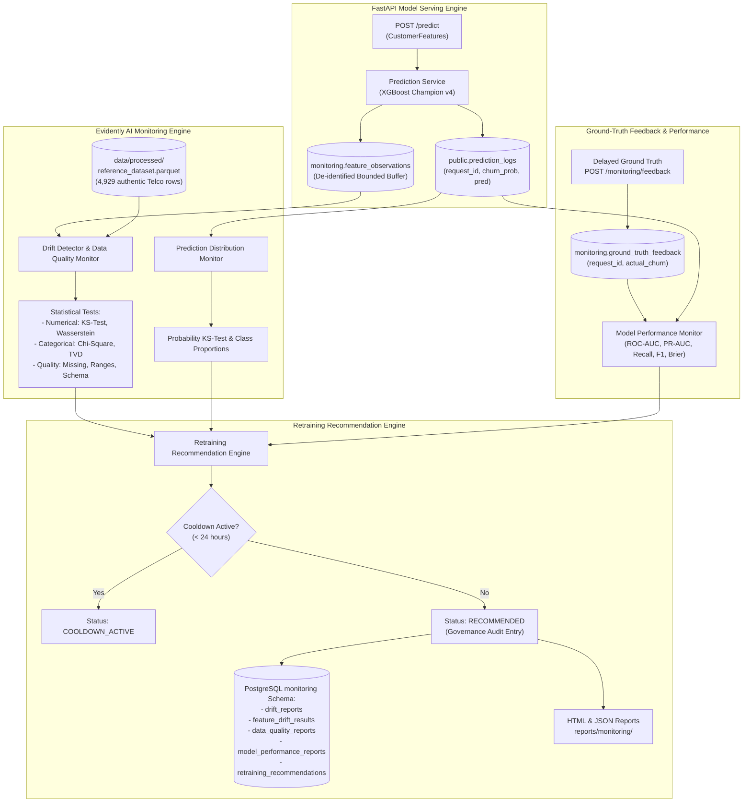

# Evidently AI Data Drift Detection & Model Monitoring Architecture

This document details the statistical data drift detection, prediction output monitoring, data quality auditing, delayed ground-truth performance evaluation, and controlled retraining recommendation workflows for **Phase 5** of the Enterprise MLOps Platform.

---

## 1. Monitoring System Architecture



---

## 2. Privacy-Aware Feature Monitoring — Critical Design

The platform strictly enforces privacy-by-design principles: **individual personal customer records are never stored in plain text or permanently retained.**

### 2.1 Information Collected
Only **de-identified model input features** are stored in the ephemeral monitoring buffer (`monitoring.feature_observations`):
- `tenure`, `MonthlyCharges`, `TotalCharges`
- `gender`, `SeniorCitizen`, `Partner`, `Dependents`, `PhoneService`, `MultipleLines`
- `InternetService`, `OnlineSecurity`, `OnlineBackup`, `DeviceProtection`, `TechSupport`
- `StreamingTV`, `StreamingMovies`, `Contract`, `PaperlessBilling`, `PaymentMethod`

**Excluded Information (Never Stored):**
- Direct identifiers (`customerID`, names, phone numbers, email addresses, home addresses, IP addresses, payment card numbers, bank account numbers).

### 2.2 Operational Purpose
Non-parametric two-sample statistical tests (Kolmogorov-Smirnov test, Wasserstein distance, Chi-square goodness-of-fit) require empirical feature samples across a monitoring window to detect statistical distribution divergence against baseline reference distributions.

### 2.3 Retention Policy & Automated Purge
- **Bounded Buffer Size**: Capped at `buffer_max_size` (default 5,000 observations). Excess observations are automatically pruned via FIFO order.
- **Time-to-Live (TTL)**: Observations older than `buffer_retention_hours` (default 72 hours) are automatically purged via background sweep.
- **Aggregate Persistence**: Once statistical drift calculations complete, all feature-level statistics (p-values, drift scores, summary statistics) are aggregated into `monitoring.drift_reports` and `monitoring.feature_drift_results`. Individual customer records are permanently deleted.

### 2.4 Non-Reconstructibility Guarantee
Individual customer identities cannot be reconstructed from monitoring tables because there are zero direct or indirect identifiers, observations use random synthetic UUIDs, and individual rows are decoupled from account records.

---

## 3. Statistical Drift Detection Methodology

### 3.1 Numerical Feature Drift
For continuous numerical features (`tenure`, `MonthlyCharges`, `TotalCharges`):
1. **Two-Sample Kolmogorov-Smirnov (KS) Test**:
   Compares empirical cumulative distribution functions (ECDF) between reference $F_{ref}(x)$ and current $F_{curr}(x)$:
   $$D_{KS} = \sup_x |F_{ref}(x) - F_{curr}(x)|$$
   A feature is flagged as drifting if the two-sided p-value is strictly less than the significance level $\alpha = 0.05$.
2. **Wasserstein Distance (Earth Mover's Distance)**:
   Measures the minimum work required to transform the current distribution into the reference distribution:
   $$W_1(u, v) = \int_{-\infty}^{\infty} |U(x) - V(x)| dx$$
   Recorded in feature summary statistics to quantify magnitude of shift.

### 3.2 Categorical Feature Drift
For categorical attributes (`Contract`, `InternetService`, `PaymentMethod`, etc.):
1. **Chi-Square Goodness-of-Fit Test**:
   Applied when expected frequencies in all categories satisfy Cochran's rule ($E_i = n_{curr} \cdot p_{ref, i} \ge 5.0$ and $n_{curr} \ge 20$):
   $$\chi^2 = \sum_{i=1}^{k} \frac{(O_i - E_i)^2}{E_i}$$
   Drift is flagged if $p < \alpha = 0.05$.
2. **Total Variation Distance (TVD) Fallback**:
   When expected cell counts are too small ($E_i < 5.0$), Chi-square p-values become distorted. The system automatically falls back to TVD:
   $$\text{TVD}(P, Q) = \frac{1}{2} \sum_{i=1}^{k} |p_i - q_i|$$
   Drift is flagged if $\text{TVD} > 0.15$ (15 percentage point distribution divergence).

### 3.3 Multiple-Comparison Protection & Dataset Drift Gating
Evaluating 19 features independently at $\alpha = 0.05$ introduces family-wise error rate ($1 - (1-0.05)^{19} \approx 62.3\%$). To avoid false alarms from random fluctuations in individual features, **dataset-level drift** is gated:
$$\text{Drift Share} = \frac{\text{Drifted Features Count}}{\text{Total Features Evaluated}} \ge 0.30 \quad (30\%)$$
A dataset drift alert is triggered only when $\ge 6$ out of 19 features exhibit statistically verified drift simultaneously.

---

## 4. Prediction Output Drift Monitoring

The platform monitors inference outputs logged in `public.prediction_logs`:
1. **Probability Distribution Shift**:
   Applies a two-sample KS test and Wasserstein distance on model output probabilities (`churn_probability`). Drift is flagged if $p < 0.05$ and $D_{KS} > 0.10$.
2. **Class Decision Balance Shift**:
   Compares the predicted churn proportion $P(\hat{y}=1)$ against the reference training population churn rate (~26.5%). Drift is flagged if the predicted churn rate diverges by more than 15 percentage points ($|P(\hat{y}=1) - 0.265| > 0.15$).

---

## 5. Delayed Ground-Truth Feedback & Performance Monitoring

The platform strictly separates **data drift** from **actual model degradation**:

| Concept | Definition | Requires Ground Truth? | Operational Meaning |
| :--- | :--- | :---: | :--- |
| **Data Drift** | Distribution of input features $P(X)$ shifted over time. | **No** | Inputs changed; model might still be performing well or poorly. |
| **Prediction Drift** | Distribution of model outputs $P(\hat{y} \mid X)$ shifted. | **No** | Model is predicting higher or lower churn rates overall. |
| **Performance Deterioration** | Supervised metrics ($P(y \mid \hat{y})$) dropped below targets. | **Yes** | Real accuracy/recall degradation confirmed by true customer outcomes. |

### 5.1 Feedback Ingestion & Label Matching
When true customer churn outcomes are confirmed (e.g. after a 30-day subscription cycle), ground truth is ingested via `POST /monitoring/feedback` or the CLI worker:
```json
{
  "request_id": "33d4888c-30cc-4581-8120-a211d85d9d98",
  "actual_churn": 1,
  "source": "crm_billing_sync"
}
```

### 5.2 Metrics Evaluated When Labels Exist
- **ROC-AUC**: Evaluates ranking ability across decision thresholds.
- **PR-AUC**: Measures precision across all recall thresholds (critical for imbalanced classes).
- **Recall**: Measures proportion of actual churners detected ($\text{Target} \ge 0.60$).
- **Precision & F1-Score**: Measures positive predictive accuracy and harmonic mean.
- **Brier Score**: Measures probability calibration quality ($\frac{1}{N} \sum (\hat{p}_i - y_i)^2$).
- **Confusion Matrix**: Exact counts for True Positives, False Positives, True Negatives, False Negatives.

### 5.3 Absence of Ground Truth
If ground truth is not supplied or the labeled sample size is below `min_sample_size` (default 50), the monitor returns `status="NO_LABELS"` or `"INSUFFICIENT_LABELS"`, and leaves metrics as `None`. **The system never fabricates performance metrics or claims accuracy has deteriorated without verified labels.**

---

## 6. Retraining Recommendation Engine & Governance

### 6.1 Trigger Conditions
The recommendation engine evaluates four independent triggers in priority order:
1. `PERFORMANCE_DROP`: Verified drop in Recall below 0.60 or PR-AUC below 0.55 when ground truth is evaluated.
2. `FEATURE_DRIFT`: Dataset drift share $\ge 30\%$ of features.
3. `PREDICTION_DRIFT`: Output probability distribution or class balance shift.
4. `DATA_QUALITY_FAIL`: Critical schema mismatch or missing value rate $> 5\%$.

### 6.2 Cooldown Protection
To prevent alert fatigue and repeated retraining triggers, a configurable cooldown period (`cooldown_hours=24`) is enforced:
- If a trigger is activated within 24 hours of a prior recommendation, status is set to `COOLDOWN_ACTIVE`.
- The timestamp when cooldown expires (`cooldown_until`) is recorded in the database.

### 6.3 Governance Boundary (Strict Architectural Invariant)
> [!IMPORTANT]
> **Drift detection NEVER automatically replaces or promotes the champion model.**
> A retraining recommendation is strictly an informational governance signal.
> Any retraining workflow must follow the complete governance pipeline:
> 1. Dataset provenance validation on fresh holdout splits.
> 2. MLflow experiment run tracking and artifact serialization.
> 3. Holdout evaluation against acceptance gates ($\text{ROC-AUC} \ge 0.83$, $\text{PR-AUC} \ge 0.65$, $\text{F1} \ge 0.58$, $\text{Latency} \le 30\text{ms}$).
> 4. Formal Champion-versus-Challenger comparison.
> 5. Human or release manager approval for MLflow model registry alias promotion.

---

## 7. PostgreSQL Database Schema (`monitoring` Schema)

| Table Name | Description | Key Columns |
| :--- | :--- | :--- |
| `monitoring.drift_reports` | Dataset-level drift summary records | `report_id`, `timestamp`, `model_name`, `model_version`, `drift_share`, `dataset_drift_detected`, `report_html_path`, `report_json_path` |
| `monitoring.feature_drift_results` | Per-feature statistical test results | `report_id`, `feature_name`, `feature_type`, `metric_name`, `drift_score`, `p_value`, `drift_detected`, `reference_stats`, `current_stats` |
| `monitoring.data_quality_reports` | Schema, missing value, and range audits | `report_id`, `timestamp`, `missing_values_share`, `out_of_range_count`, `unexpected_categories_count`, `quality_status` |
| `monitoring.prediction_distribution_reports` | Probability and class drift records | `report_id`, `timestamp`, `mean_probability`, `predicted_churn_rate`, `ks_statistic`, `probability_drift_detected` |
| `monitoring.ground_truth_feedback` | Delayed ground truth labels | `request_id`, `actual_churn`, `feedback_timestamp`, `source` |
| `monitoring.model_performance_reports` | Supervised model evaluation records | `report_id`, `timestamp`, `roc_auc`, `pr_auc`, `recall`, `f1_score`, `brier_score`, `confusion_matrix`, `status` |
| `monitoring.retraining_recommendations` | Decision guidance and audit log | `recommendation_id`, `timestamp`, `trigger_reason`, `recommendation_status`, `cooldown_until`, `remediation_steps` |
| `monitoring.feature_observations` | De-identified ephemeral feature buffer | `observation_id`, `timestamp`, `tenure`, `MonthlyCharges`, `TotalCharges`, `gender`, `Contract`, `InternetService`, ... |

---

## 8. Operational Commands Reference

### 8.1 CLI Worker Operations
```bash
# Check current monitoring status and latest evaluations
python -m src.monitoring.worker --status

# Execute a single on-demand monitoring cycle
python -m src.monitoring.worker --run-once

# Ingest an external de-identified observation batch
python -m src.monitoring.worker --ingest-observations data/samples/sample_churn_input.csv

# Ingest delayed ground-truth labels
python -m src.monitoring.worker --ingest-ground-truth data/samples/ground_truth_sample.csv

# Purge expired observations from the ephemeral buffer
python -m src.monitoring.worker --purge

# Run continuous background monitoring daemon (e.g. hourly)
python -m src.monitoring.worker --daemon --interval-seconds 3600
```

### 8.2 FastAPI Monitoring REST Endpoints
```bash
# Query current monitoring status
curl http://localhost:8000/monitoring/status

# Retrieve the latest dataset drift report summary
curl http://localhost:8000/monitoring/latest

# Trigger an authenticated on-demand monitoring cycle
curl -X POST http://localhost:8000/monitoring/run \
  -H "X-Admin-API-Key: dev-admin-secret-key-phase3"

# Submit delayed ground-truth feedback
curl -X POST http://localhost:8000/monitoring/feedback \
  -H "Content-Type: application/json" \
  -d '{"request_id": "33d4888c-30cc-4581-8120-a211d85d9d98", "actual_churn": 1}'
```

### 8.3 Docker Compose Execution
The monitoring worker is orchestrated as an independent service in `docker-compose.yml`:
```bash
# Start core services including monitoring worker
docker compose up -d

# Inspect monitoring worker logs
docker compose logs -f monitoring
```
