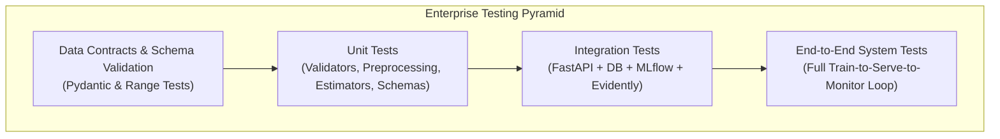
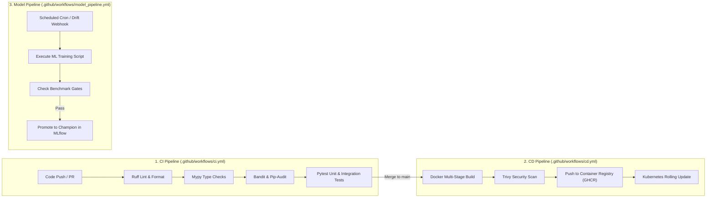
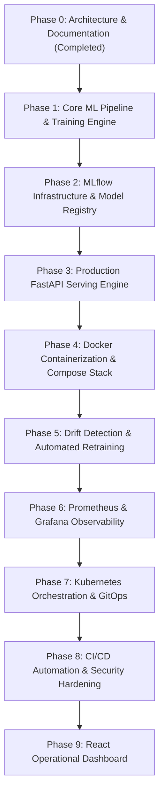

# Implementation Roadmap, Testing Strategy & CI/CD Workflow

## 1. Testing Strategy

The platform enforces testing across all layers of the machine learning and software stack:

### Testing Categories & Tooling

1. **Unit Testing (`pytest`)**:
   - **Data Validation Tests**: Missing field handling, invalid categorical value rejection, type coercion.
   - **Preprocessing Tests**: Verify zero leakage (no statistics leaked from test to train), transformer invariance, missing imputation behavior.
   - **Model Tests**: Determinism (fixed random seeds), output probability shape checks $[0.0, 1.0]$, gradient checks.
   - **Schema Tests**: Pydantic input/output serialization and deserialization.

2. **Integration Testing (`pytest-asyncio`, `testcontainers`)**:
   - **Inference API**: Mocked and live model inference endpoints, HTTP status codes, error payload schemas.
   - **Database Logging**: Verifies prediction logs and ground-truth feedback are correctly recorded in PostgreSQL.
   - **MLflow Tracking**: Verifies runs are logged with parameters, metrics, tags, and loadable serialized pipelines.
   - **Drift Calculation**: Tests Evidently AI drift calculations on synthetic drifting data.

3. **Performance & Stress Testing (`locust`)**:
   - Verifies API meets $\le 25\text{ ms}$ (p95) latency SLA under concurrent loads of $100\text{ RPS}$ to $500\text{ RPS}$.
   - Evaluates memory footprint and identifies memory leaks during continuous prediction logging.

4. **Security Testing (`bandit`, `pip-audit`, `trivy`)**:
   - Static analysis for Python code vulnerabilities (`bandit`).
   - Software bill-of-materials and dependency vulnerability checks (`pip-audit`).
   - Container image vulnerability scanning (`trivy`).

---

## 2. CI/CD Workflow Specification (GitHub Actions)

The deployment pipeline is automated via three dedicated GitHub Actions workflows:

---

## 3. Phased Implementation Roadmap

To maintain engineering discipline and prevent untested sprawl, development is strictly partitioned into verified phases:

### Detailed Phase Milestones & Acceptance Criteria

| Phase | Title | Scope & Deliverables | Verification / Acceptance Gate |
| :--- | :--- | :--- | :--- |
| **Phase 0** *(Current)* | **Architecture & Blueprints** | System designs, repository structure, DB schemas, docs, `.gitignore`, `.env.example`. | Formal architect review and user sign-off. |
| **Phase 1** | **Core ML Pipeline & Training** | Telco Churn dataset ingestion, Pydantic contracts, Scikit-learn pipelines, XGBoost modeling, Optuna tuning, evaluation metrics, SHAP explainability. | 100% passing unit tests, zero data leakage, ROC-AUC $\ge 0.83$, PR-AUC $\ge 0.65$. |
| **Phase 2** | **MLflow Governance** | MLflow tracking setup, PostgreSQL backend, MinIO artifact store, model signatures, candidate/challenger/champion promotion gating. | Models registered with full lineage, artifacts, and verified signatures. |
| **Phase 3** | **FastAPI Serving Engine** | Asynchronous inference endpoints (`/predict`, `/predict-batch`), health probes (`/health/live`, `/ready`, `/startup`), DB prediction logger, API security. | Endpoints tested with valid & invalid payloads; latency p95 $\le 25\text{ms}$; DB records confirmed. |
| **Phase 4** | **Docker Containerization** | Multi-stage Dockerfiles (`api`, `mlflow`, `evidently`), non-root permissions, local `docker-compose.yml` stack orchestration. | All 8 services initialize cleanly with green healthchecks; end-to-end local inference works. |
| **Phase 5** | **Drift Detection & Retraining** | Evidently AI drift worker, KS & Chi-square statistical testing, report generator (HTML/JSON), retraining controller & webhook. | Simulated drifted payload triggers drift alert and automated retraining run. |
| **Phase 6** | **Prometheus & Grafana** | Prometheus `/metrics` instrumentation, Prometheus scrape configs, Grafana operational & ML dashboards provisioned. | Real-time RPS, latency histograms, and prediction distributions visible in Grafana. |
| **Phase 7** | **Kubernetes Deployment** | Kubernetes manifests (Deployment, Service, Ingress, HPA, ConfigMaps, Secrets, PVCs), zero-downtime rolling updates. | Deployable to local Minikube/Kind or remote cluster with passing probes. |
| **Phase 8** | **CI/CD & Security Hardening** | GitHub Actions workflows (`ci.yml`, `cd.yml`, `model_pipeline.yml`), Bandit, Pip-audit, Trivy container security scans. | Automated build, test, and scan passes on GitHub Actions. |
| **Phase 9** | **React Operational Dashboard** | Modern React UI: Model management, real-time prediction playground, drift reports view, manual retrain trigger. | Interactive web dashboard communicating with FastAPI backend. |

---

## 4. Current Phase Status

> [!IMPORTANT]
> **Phase 0 is complete.** Architectural specifications, data schemas, deployment models, and the phased implementation roadmap have been compiled. In accordance with engineering governance rules, implementation of Phase 1 will commence upon user review and approval.
