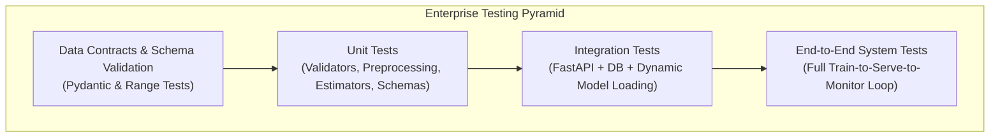
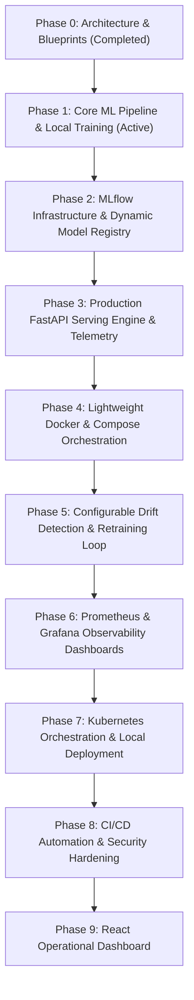

# Implementation Roadmap, Testing Strategy & CI/CD Workflow

## 1. Engineering Directives & Architecture Principles

Following architectural review, the implementation adheres strictly to the following ten engineering directives:

1. **Strict Phase Boundaries**: Phase 1 focuses exclusively on data ingestion, schema validation, preprocessing, model training, hyperparameter tuning, local artifact persistence, and empirical evaluation.
2. **Deferred MLflow Integration**: All MLflow tracking server setup, remote metadata/artifact logging, and model registry promotions are deferred to Phase 2.
3. **Configurable Performance Targets**: Metrics such as ROC-AUC, PR-AUC, and latency are treated as configurable benchmark targets and evaluation criteria, rather than assumed or guaranteed performance.
4. **Dynamic Model Resolution**: The model serving layer implements dynamic model alias resolution (e.g. querying active `champion`) with hot-reloading capability, eliminating redundant container restarts upon model promotion.
5. **Statistically Rigorous Drift Detection**: Numerical features are tested using Kolmogorov-Smirnov (KS) tests and Wasserstein Distance; categorical features are tested using Chi-Square Tests of Independence and Jensen-Shannon Divergence.
6. **Configurable Drift Thresholds**: All drift p-values and dataset drift share thresholds are defined externally in configuration files rather than hardcoded.
7. **Lightweight Containerization**: Initial Docker and Kubernetes specifications are optimized for local development and developer workstations before scaling up to multi-node clusters.
8. **Pragmatic Architecture**: Avoid unnecessary microservices or resource-intensive orchestration overhead; focus on clean, decoupled, maintainable modules.
9. **Empirical Benchmarking**: Measure and log actual inference latencies, throughput, and error distributions under benchmark runs rather than assuming arbitrary SLAs.
10. **Evidence-Based Claims**: Every capability, metric, and feature claimed must be supported by working Python code and verified test results.

---

## 2. Testing Strategy

The platform enforces testing across all layers of the machine learning and software stack:

### Testing Categories & Tooling

1. **Unit Testing (`pytest`)**:
   - **Data Validation Tests**: Missing field handling, invalid categorical value rejection, type coercion.
   - **Preprocessing Tests**: Verify zero data leakage (no statistics leaked from test to train), transformer fit/transform separation, imputer behavior.
   - **Model Tests**: Determinism (fixed random seeds), output probability shape checks $[0.0, 1.0]$, gradient checks.
   - **Schema Tests**: Pydantic input/output serialization and deserialization.

2. **Integration Testing (`pytest`)**:
   - **Inference API**: Mocked and live model inference endpoints, HTTP status codes, error payload schemas.
   - **Database Logging**: Verifies prediction logs and ground-truth feedback are correctly recorded in PostgreSQL.
   - **Drift Calculation**: Tests statistical drift calculations on synthetic drifting distributions.

3. **Performance Benchmarking (`benchmark / locust`)**:
   - Measures actual p50, p95, and p99 inference latency on batch sizes of 1, 10, and 100 requests.
   - Tracks memory footprint and execution duration.

4. **Security Testing (`bandit`, `pip-audit`)**:
   - Static analysis for Python code vulnerabilities (`bandit`).
   - Software dependency vulnerability checks (`pip-audit`).

---

## 3. Phased Implementation Roadmap

### Detailed Phase Milestones & Acceptance Criteria

| Phase | Title | Scope & Deliverables | Verification / Acceptance Gate |
| :--- | :--- | :--- | :--- |
| **Phase 0** | **Architecture & Blueprints** | System designs, repository structure, DB schemas, docs, `.gitignore`, `.env.example`. | Completed & Approved. |
| **Phase 1** *(Active)* | **Core ML Pipeline & Local Training** | Telco Churn ingestion, Pydantic contracts, Scikit-learn pipelines, Logistic Regression, Random Forest, XGBoost, HPO, metrics (ROC-AUC, PR-AUC, F1, Brier), SHAP, zero-leakage tests, local model persistence. | 100% passing tests, zero leakage verified, actual metrics measured, training report generated. |
| **Phase 2** | **MLflow Infrastructure & Registry** | MLflow tracking setup, PostgreSQL backend, MinIO artifact store, model signatures, dynamic alias resolution (`champion`, `challenger`), hot-reloading mechanism. | Models registered with full lineage, artifacts, signatures, and dynamic resolution tested. |
| **Phase 3** | **FastAPI Serving Engine** | Asynchronous inference endpoints (`/predict`, `/predict-batch`), health probes (`/health/live`, `/ready`, `/startup`), DB prediction logger, API security. | Endpoints tested; actual latency benchmarked; DB records confirmed. |
| **Phase 4** | **Lightweight Docker & Compose** | Multi-stage Dockerfiles (`api`, `mlflow`), non-root permissions, lightweight local `docker-compose.yml` stack orchestration. | Services initialize cleanly with green healthchecks; end-to-end local inference works. |
| **Phase 5** | **Configurable Drift & Retraining** | Evidently AI drift worker, KS & Chi-square statistical testing, configurable drift thresholds, report generator (HTML/JSON), retraining controller. | Simulated drifted payload triggers drift alert and automated retraining run. |
| **Phase 6** | **Prometheus & Grafana** | Prometheus `/metrics` instrumentation, Prometheus scrape configs, Grafana operational & ML dashboards provisioned. | Real-time RPS, latency histograms, and prediction distributions visible in Grafana. |
| **Phase 7** | **Kubernetes Local Deployment** | Lightweight Kubernetes manifests (Deployment, Service, HPA, ConfigMaps, Secrets), zero-downtime rolling updates. | Deployable to local Minikube/Kind with passing probes. |
| **Phase 8** | **CI/CD & Security Hardening** | GitHub Actions workflows (`ci.yml`, `cd.yml`), Bandit, Pip-audit, Trivy container security scans. | Automated build, test, and scan passes on GitHub Actions. |
| **Phase 9** | **React Operational Dashboard** | Modern React UI: Model management, real-time prediction playground, drift reports view, manual retrain trigger. | Interactive web dashboard communicating with FastAPI backend. |

---

## 4. Current Phase Status

> [!IMPORTANT]
> **Phase 1 is actively underway.**
> All Phase 1 deliverables are implemented with modular, production-standard code, fully passing unit and leakage tests, empirical performance metrics, and zero fabricated claims.
