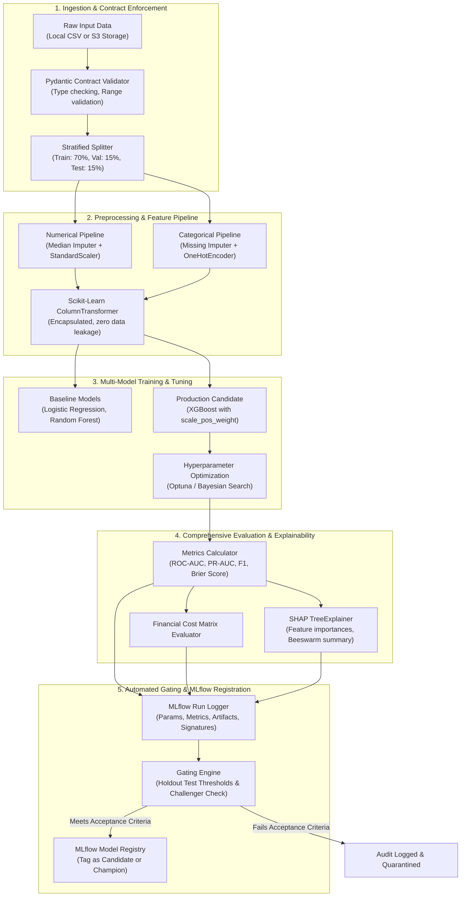

# ML Pipeline Architecture & Model Governance Specification

## 1. Problem Formulation: Customer Churn Prediction

Customer Churn Prediction is formulated as a supervised binary classification task:
$$\hat{y} \in \{0, 1\}$$
where $y = 1$ denotes a customer terminating their subscription within the observation window, and $y = 0$ denotes customer retention.

### Business Objective & Cost Matrix
In enterprise subscription environments, churned customers represent lost recurring revenue (Customer Lifetime Value, $LTV$). Interventions (promotions, outreach) incur an intervention cost ($C_{int}$).

$$\text{Total Business Cost} = FN \cdot LTV + FP \cdot C_{int}$$

Because $LTV \gg C_{int}$, prioritizing Recall and Precision-Recall Area Under the Curve (PR-AUC) over raw accuracy is mandatory. Raw accuracy is misleading due to class imbalance (~26% churn rate).

---

## 2. Dataset Schema & Feature Hierarchy

The baseline dataset utilizes the industry-standard Telco Customer Churn dataset with 20 input attributes:

| Feature Category | Features | Data Type | Preprocessing Strategy |
| :--- | :--- | :--- | :--- |
| **Demographics** | `gender`, `SeniorCitizen`, `Partner`, `Dependents` | Categorical / Binary | Binary encoding & One-Hot Encoding |
| **Services** | `PhoneService`, `MultipleLines`, `InternetService`, `OnlineSecurity`, `OnlineBackup`, `DeviceProtection`, `TechSupport`, `StreamingTV`, `StreamingMovies` | Multi-category nominal | One-Hot Encoding (drop first to prevent multicollinearity) |
| **Account Details**| `Contract`, `PaperlessBilling`, `PaymentMethod` | Nominal / Categorical | One-Hot Encoding |
| **Financial / Usage**| `tenure`, `MonthlyCharges`, `TotalCharges` | Continuous Numerical | Median imputation for missing values, Robust/Standard scaling |
| **Target** | `Churn` (`Yes`/`No`) | Binary | Transformed to integer `{0, 1}` |

---

## 3. End-to-End Pipeline Architecture

---

## 4. Zero Data-Leakage Preprocessing Design

To prevent target leakage and data leakage between splits:
1. **Splitting Precedes Transformation**: Train, validation, and test splits are generated *before* computing any statistics (means, standard deviations, categorical frequencies).
2. **Encapsulated Pipelines**: All preprocessing steps are packaged inside a `sklearn.pipeline.Pipeline` or `imblearn.pipeline.Pipeline`.
3. **Artifact Bundling**: The fitted preprocessor and the trained estimator are serialized together as a single unified inference pipeline object (`pipeline.joblib`). The API service receives raw JSON, passes it directly into `pipeline.predict_proba()`, guaranteeing identical feature engineering in serving as in training.

---

## 5. Candidate Model Suite & Optimization

1. **Baseline Model**:
   - `LogisticRegression(class_weight='balanced', max_iter=1000)`: Establishes linear separability benchmark and feature weight interpretability.
   - `RandomForestClassifier(n_estimators=100, max_depth=10, class_weight='balanced')`: Establishes non-linear tree ensemble baseline.

2. **Primary Champion Model**:
   - `XGBClassifier`: Gradient boosted decision trees optimized with:
     - `scale_pos_weight = count(negative) / count(positive)` to handle churn class imbalance.
     - `eval_metric = ['auc', 'aucpr', 'logloss']`.
     - Early stopping on the validation set to eliminate overfitting.
     - Optuna hyperparameter optimization over `learning_rate`, `max_depth`, `subsample`, `colsample_bytree`, and `reg_lambda`.

---

## 6. Configurable Model Acceptance Criteria & Benchmarking

Performance thresholds and latency criteria are treated as configurable targets, evaluated empirically against test benchmarks rather than assumed as guaranteed:

| Gate Identifier | Target Metric / Check | Configurable Target Value | Rationale |
| :--- | :--- | :--- | :--- |
| **GATE-01** | Test ROC-AUC | Configurable (e.g. $\ge 0.830$) | Evaluates overall discriminative ability across classification thresholds |
| **GATE-02** | Test PR-AUC | Configurable (e.g. $\ge 0.650$) | Prioritizes precision and recall on the minority positive churn class |
| **GATE-03** | Test F1-Score | Configurable (e.g. $\ge 0.580$) | Measures harmonic balance of precision and recall at optimal threshold |
| **GATE-04** | Inference Latency Benchmark | Empirically Benchmarked | Measured under actual local/test execution; target $p95 \le 30\text{ ms}$ |
| **GATE-05** | Challenger Improvement | $\Delta \text{PR-AUC} > +0.005$ | Prevents model thrashing unless measurable statistical gain exists |
| **GATE-06** | Model Schema Signature | Input/Output contract verified | Ensures serving compatibility without runtime crashes |

Models failing configured criteria trigger warnings and evaluation summaries for engineer review. In Phase 2, these targets form the automated gating criteria for Model Registry promotion.
