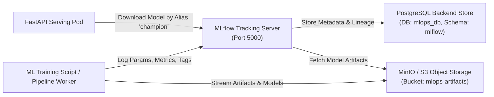
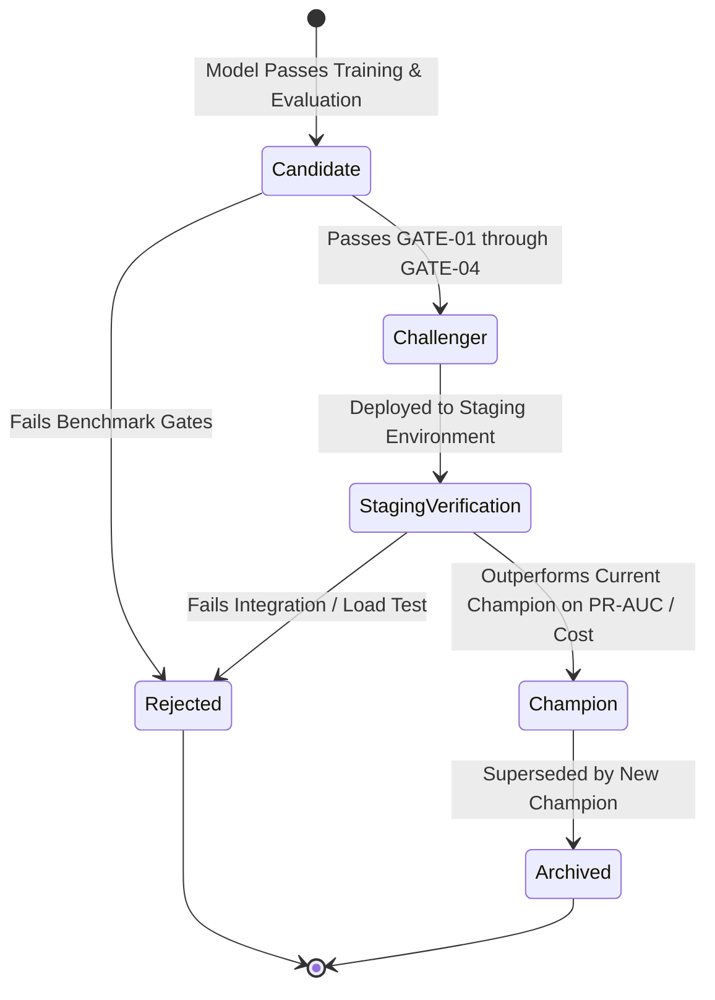

# MLflow Experiment Tracking & Model Registry Specification

## 1. Tracking Server Infrastructure Architecture

MLflow operates in an enterprise distributed topology decoupling the metadata database from binary artifact storage:



### Components
1. **Backend Store**: PostgreSQL 15+ hosting MLflow system tables (runs, experiments, tags, parameters, metrics history).
2. **Artifact Store**: S3-compatible Object Storage (MinIO for local dev/testing, AWS S3 or GCP Cloud Storage for cloud production).
3. **Tracking Server**: Centralized MLflow REST API server exposed with authentication and role-based access.

---

## 2. Experiment Hierarchy & Naming Conventions

Experiments are categorized strictly by functional intent to isolate ad-hoc exploration from scheduled production retraining:

| Experiment Name | Purpose | Retention Policy | Gating Required |
| :--- | :--- | :--- | :--- |
| `customer-churn/exploration` | Ad-hoc feature engineering, exploratory modeling | 30 days | No |
| `customer-churn/training` | Formal model development, benchmark runs | Indefinite | Yes |
| `customer-churn/retraining` | Automated drift-triggered retraining pipelines | Indefinite | Yes (Strict Champion Gate) |
| `customer-churn/evaluation` | Periodic offline evaluation runs against fresh ground truth | Indefinite | No |

---

## 3. Run Metadata & Artifact Logging Specification

Each training run must record standard structured metadata according to this schema:

### Parameters
- `pipeline.numeric_imputer_strategy`: `median`
- `pipeline.categorical_imputer_strategy`: `constant`
- `pipeline.scaler`: `StandardScaler`
- `model.algorithm`: `XGBClassifier`
- `model.learning_rate`: `float`
- `model.max_depth`: `int`
- `model.n_estimators`: `int`
- `model.subsample`: `float`
- `model.colsample_bytree`: `float`
- `model.scale_pos_weight`: `float`
- `dataset.split_seed`: `42`
- `dataset.test_ratio`: `0.15`

### Metrics (Logged across Train, Val, and Holdout Test)
- `train_roc_auc`, `val_roc_auc`, `test_roc_auc`
- `train_pr_auc`, `val_pr_auc`, `test_pr_auc`
- `train_f1`, `val_f1`, `test_f1`
- `test_brier_score`
- `test_expected_cost`
- `inference_latency_p95_ms`
- `training_duration_seconds`

### Tags
- `git.commit`: Commit SHA triggering the training run
- `git.branch`: Branch name (`main`, `release/*`)
- `dataset.version`: Hash or version string of input dataset
- `environment`: `development` | `staging` | `production`
- `trigger`: `manual` | `scheduled_ci` | `drift_event`
- `author`: Committer identity or automated service account

### Artifacts Directory Structure
```text
runs:/<run-id>/
├── model/
│   ├── MLmodel                     # MLflow model format specification
│   ├── model.pkl / pipeline.joblib # Full serialised sklearn/xgboost pipeline
│   ├── conda.yaml                  # Reproducible Conda environment
│   └── requirements.txt            # Exact pip dependency lock
├── figures/
│   ├── confusion_matrix.png        # Evaluated on test set
│   ├── roc_curve.png               # ROC curve with AUC annotation
│   ├── pr_curve.png                # Precision-Recall curve
│   └── shap_summary.png            # SHAP beeswarm plot of feature impact
├── data_profile/
│   ├── schema.json                 # Pydantic input schema snapshot
│   └── baseline_statistics.json    # Reference statistics for Evidently drift
└── evaluation/
    └── metrics_summary.json        # Comprehensive numeric metrics breakdown
```

---

## 4. Model Registry Lifecycle & Aliasing Strategy

The platform uses MLflow Model Registry **Model Aliases** (`champion`, `challenger`, `candidate`, `archived`) to enable progressive deployment:



### Governance Rules
1. **Model Aliases**:
   - `candidate`: Newly trained model logged to registry pending validation.
   - `challenger`: Qualified model undergoing automated shadow testing and staging verification.
   - `champion`: The authoritative production model served to live clients. Only one model version can hold the `champion` alias at any given time.
   - `archived`: Retired production model kept for auditability and rollback capability.
2. **Immutable Signatures**:
   Every registered model must declare an explicit MLflow `ModelSignature` specifying input feature column names, data types, and output tensor types. Models missing signatures cannot be promoted to `champion`.
3. **Automated Rollback**:
   If the active `champion` exhibits unexpected runtime errors or latency spikes in production, the serving layer can switch aliases back to the previous stable version in under 10 seconds without container redeployment.
