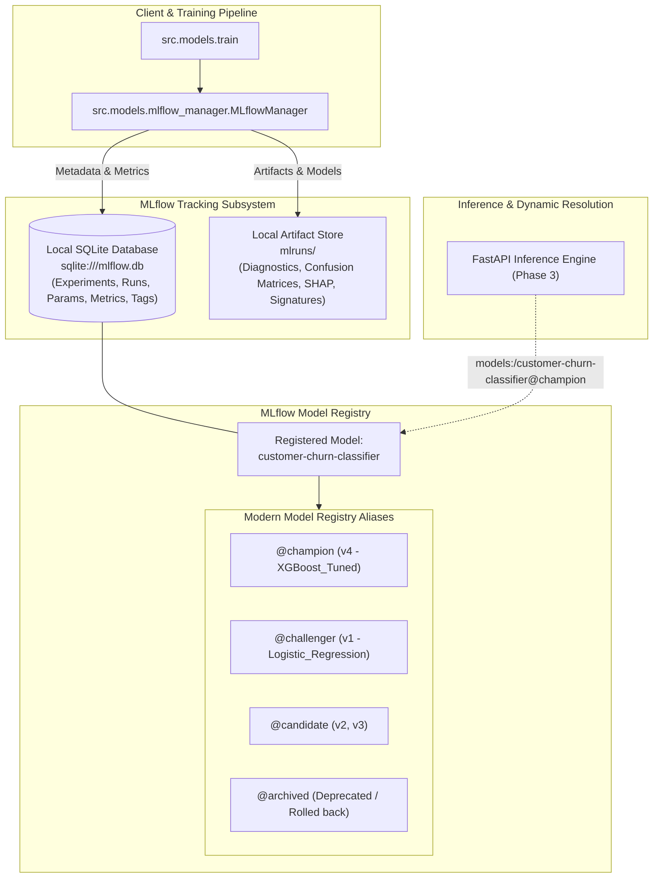

# MLflow Experiment Tracking & Model Registry Implementation

This document describes the design, architecture, and operational mechanics of the **MLflow Experiment Tracking and Model Registry Lifecycle Management** subsystem implemented in **Phase 2** of the Enterprise MLOps Platform.

---

## 1. Architectural Overview

The MLflow integration provides an enterprise-grade, reproducible experiment tracking and model registry layer without introducing unnecessary infrastructure overhead during local development.



---

## 2. Tracking Backend & Artifact Storage Design

### 2.1 Lightweight Local Development Configuration
- **Tracking URI**: `sqlite:///mlflow.db` (SQLite relational database located in the project root).
- **Artifact Location**: `./mlruns` (directory-backed filesystem store for serialized models, figures, and explainability plots).
- **Environment Isolation**: Configured strictly via `configs/config.yaml` and loaded dynamically via `AppConfig`.

### 2.2 Seamless Production / Docker Migration Path
The architecture requires zero code changes to transition from local SQLite to a production-grade distributed stack:
- **Local Dev**:
  ```yaml
  mlflow:
    tracking_uri: "sqlite:///mlflow.db"
    artifact_location: "mlruns"
  ```
- **Docker / Kubernetes Production Stack (Phase 4)**:
  ```yaml
  mlflow:
    tracking_uri: "postgresql+psycopg2://${POSTGRES_USER}:${POSTGRES_PASSWORD}@${POSTGRES_HOST}:5432/${POSTGRES_DB}"
    artifact_location: "s3://${MINIO_BUCKET_NAME}/artifacts"
  ```
Because `MLflowManager` consumes standard MLflow URIs without hardcoded database logic, changing environment variables or `config.yaml` seamlessly retargets tracking and model storage.

---

## 3. Experiment Tracking & Run Logging

### 3.1 Strict Provenance & Reproducibility Tags
Every training execution records cryptographic and environment metadata directly into MLflow run tags:
- `git_commit`: HEAD Git commit SHA (`2fc5b35...`) ensuring exact code state reproducibility.
- `dataset_source`: Origin descriptor (`canonical_ibm_telco_churn`).
- `dataset_sha256`: SHA-256 cryptographic digest of raw data (`16320c9c1ec72448db59aa0a26a0b95401046bef5d02fd3aeb906448e3055e91`).
- `dataset_is_real`: Boolean indicator verifying whether genuine or synthetic data was used.
- `python_version`, `sklearn_version`, `xgboost_version`, `mlflow_version`: Exact runtime dependency versions.

### 3.2 Partition Isolation (Separate Train, Validation, and Test Metrics)
To prevent data leakage and evaluate real-world generalization, metrics are logged into separate metric namespaces:
- **Training Metrics**: `train_roc_auc`, `train_pr_auc`, `train_f1`, `train_brier_score`
- **Validation Metrics**: `val_roc_auc`, `val_pr_auc`, `val_f1`, `val_brier_score`, `val_optimal_threshold`
- **Holdout Test Metrics**: `test_roc_auc`, `test_pr_auc`, `test_f1`, `test_precision`, `test_recall`, `test_brier_score`, `test_total_cost`, `test_latency_p95_ms`, `test_latency_mean_ms`

### 3.3 Diagnostic Artifact Logging
Each candidate model run logs rich evaluation artifacts under its MLflow run artifact tree:
- Multi-model comparative ROC curves (`roc_curve_comparison.png`)
- Precision-Recall curves (`pr_curve_comparison.png`)
- Metric comparison bar charts (`model_metrics_comparison.png`)
- Confusion matrix heatmaps for the champion (`confusion_matrix.png`)
- Global SHAP summary beeswarm plot (`shap_summary.png`)
- Top-feature SHAP importance ranking plot (`shap_importance_bar.png`)
- JSON feature importance audit records (`shap_importances.json`)

---

## 4. Model Encapsulation, Signatures & Serialization

### 4.1 Scikit-learn Pipeline Encapsulation
Every registered model encapsulates the complete end-to-end inference workflow inside a Scikit-learn `Pipeline`:
1. `preprocessor`: `ColumnTransformer` (numerical median imputer + robust scaler, categorical frequent imputer + one-hot encoder with unknown category handling).
2. `classifier`: The fitted estimator (Logistic Regression, Random Forest, or XGBoost).

Inference clients pass raw feature DataFrames directly into `predict()` or `predict_proba()` without external preprocessing code, eliminating training-serving skew.

### 4.2 Model Signatures and Input Examples
Models are logged with explicit schema contracts:
```python
X_example = X_sample.head(2)
y_pred_example = pipeline.predict_proba(X_example)
signature = infer_signature(X_example, y_pred_example)

mlflow.sklearn.log_model(
    sk_model=pipeline,
    name="model",
    serialization_format=mlflow.sklearn.SERIALIZATION_FORMAT_CLOUDPICKLE,
    signature=signature,
    input_example=X_example,
    registered_model_name="customer-churn-classifier",
)
```
- **Serialization**: Uses `SERIALIZATION_FORMAT_CLOUDPICKLE` to maintain compatibility with custom Scikit-learn transformers and XGBoost estimators across Python 3.12 environments.
- **Input Example**: Captures concrete feature rows to provide automated inference documentation in the MLflow UI.

---

## 5. Model Registry Lifecycle Management

### 5.1 Supported Registry Aliases
In accordance with MLflow 2.x/3.x architectural standards (replacing deprecated stages like "Staging" and "Production"), model versions are governed using **Model Registry Aliases**:
- `@champion`: The active production model serving live traffic.
- `@challenger`: The primary runner-up candidate slated for shadow deployment or A/B testing.
- `@candidate`: Newly trained models awaiting gating evaluation or benchmark comparison.
- `@archived`: Superseded champion models or rolled-back versions preserved for audit history.

### 5.2 Automated Champion-vs-Challenger Promotion Gating
Models are never promoted blindly. Gating rules configured in `configs/config.yaml` enforce strict quantitative quality standards:

```yaml
mlflow:
  gating:
    min_roc_auc: 0.83
    min_pr_auc: 0.65
    min_f1: 0.58
    max_latency_p95_ms: 30.0
    min_improvement_pr_auc: 0.005
```

#### Evaluation Rules:
1. **Gate 1 (ROC-AUC)**: Holdout Test ROC-AUC $\ge 0.83$.
2. **Gate 2 (PR-AUC)**: Holdout Test PR-AUC $\ge 0.65$.
3. **Gate 3 (F1-Score)**: Holdout Test Calibrated F1 $\ge 0.58$.
4. **Gate 4 (Latency SLA)**: 95th percentile inference latency $\le 30.0\text{ ms}$.
5. **Gate 5 (Challenger vs Champion Improvement)**: When an active champion exists, the challenger must outperform the champion in PR-AUC by at least $\Delta \ge +0.005$ without breaching cost or latency targets.

If no champion is currently active, the first candidate meeting Gates 1–4 is promoted to `@champion`. When a new champion is promoted, the previous champion is atomically demoted to `@archived`.

### 5.3 Automated Registry Rollback
If an operational defect is discovered in production, the rollback mechanism atomically demotes the problematic version to `@archived` (tagged with `lifecycle_state="rolled_back"`) and restores the designated previous stable version to `@champion`:

```python
rollback_result = mlflow_mgr.rollback_champion()
# Verifies that client.get_model_version_by_alias('champion') resolves to previous version
assert rollback_result.success is True
```

### 5.4 Dynamic Model Loading Resolution
Downstream serving layers (e.g. FastAPI in Phase 3) load models using alias URIs:
```python
champion_pipeline = mlflow.sklearn.load_model("models:/customer-churn-classifier@champion")
```
When an alias is updated or rolled back in the registry, subsequent model loads dynamically resolve to the updated version without application rebuilds or redeployments.

---

## 6. Verification & Test Suite

The test suite in `tests/unit/test_mlflow_registry.py` provides automated verification for all registry operations using isolated SQLite backends:

| Test Case | Verification Target | Status |
| :--- | :--- | :---: |
| `test_mlflow_experiment_initialization` | Experiment creation, SQLite schema generation, artifact store binding | **PASSED** |
| `test_mlflow_log_model_run_and_registration` | Parameters, separate split metrics (train/val/test), tags, signatures, candidate alias assignment | **PASSED** |
| `test_champion_challenger_gating_and_promotion` | Initial champion promotion, failing gate 5 rejection, passing gate 5 promotion, atomic demotion to archived | **PASSED** |
| `test_registry_rollback_functionality` | Champion demotion to archived, restoration of prior version, alias resolution verification | **PASSED** |
| `test_dynamic_model_loading_and_prediction_consistency` | Loading via `models:/...@{alias}`, prediction parity against memory pipeline | **PASSED** |

### Complete Test Suite Execution:
- **Total Tests**: 25 passed, 0 failed.
- **Coverage**: Data validation, leakage prevention, preprocessor isolation, model training determinism, latency benchmarking, optimal F1 threshold calibration, and MLflow registry lifecycle.

---

## 7. Operational Instructions

### Launching the MLflow UI
To view experiment runs, metrics, curves, and registered model versions:
```bash
# From repository root
mlflow ui --backend-store-uri sqlite:///mlflow.db --port 5000
```
Then open `http://localhost:5000` in a browser.

### Inspecting Models in Python
```python
from src.models.mlflow_manager import MLflowManager

mgr = MLflowManager()
champ_version = mgr.get_model_version_by_alias("champion")
print(f"Current Champion Version: {champ_version.version} (Run ID: {champ_version.run_id})")

# Load champion pipeline directly
model = mgr.load_model_by_alias("champion")
predictions = model.predict_proba(sample_df)
```
