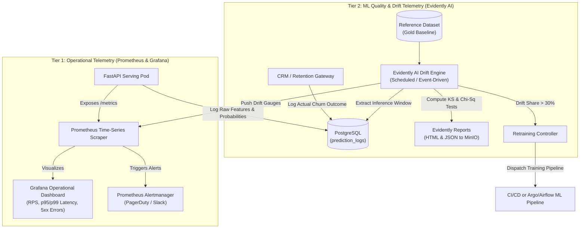
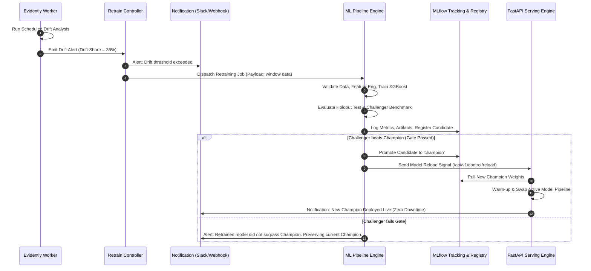

# Monitoring, Drift Detection & Retraining Architecture

## 1. Unified Observability Strategy

The platform deploys a two-tier observability paradigm addressing both **System Reliability** and **Machine Learning Integrity**:

---

## 2. Prometheus Metrics Catalog

The FastAPI application instruments runtime telemetry using `prometheus_client`:

| Metric Name | Type | Labels | Description / SLA |
| :--- | :--- | :--- | :--- |
| `mlops_http_requests_total` | Counter | `method`, `endpoint`, `status` | Total incoming API requests |
| `mlops_inference_duration_seconds` | Histogram | `model_version`, `model_name` | Latency distribution ($p95 \le 25\text{ms}$) |
| `mlops_predictions_total` | Counter | `model_version`, `predicted_class` | Total inferences by predicted label (0 or 1) |
| `mlops_prediction_probability` | Histogram | `model_version` | Histogram of output probability scores |
| `mlops_feature_drift_share` | Gauge | `model_version` | Ratio of drifted features ($0.0 \dots 1.0$) |
| `mlops_dataset_drift_detected` | Gauge | `model_version` | Binary indicator ($1 = \text{drifted}, 0 = \text{stable}$) |
| `mlops_active_model_info` | Gauge | `model_name`, `model_version`, `git_commit` | Active loaded model metadata |

---

## 3. Data Drift Detection Methodology (Evidently AI)

Data drift occurs when the production feature distribution $P_{prod}(X)$ diverges from the baseline training distribution $P_{train}(X)$, leading to silent model performance degradation without software errors.

### Statistical Testing Protocol

Features are evaluated against the baseline reference dataset using non-parametric statistical tests matching feature variable types:

| Feature Variable Type | Features | Statistical Test | Drift Criterion |
| :--- | :--- | :--- | :--- |
| **Continuous Numerical** | `tenure`, `MonthlyCharges`, `TotalCharges` | Two-sample Kolmogorov-Smirnov (KS) test & Wasserstein Distance | KS $p\text{-value} < 0.05$ or Wasserstein Distance $> 0.1$ |
| **Categorical / Nominal** | `Contract`, `PaymentMethod`, `InternetService`, `OnlineSecurity`, etc. | Chi-Square Test of Independence & Jensen-Shannon (JS) Distance | Chi-Square $p\text{-value} < 0.05$ or JS Distance $> 0.1$ |
| **Binary Indicators** | `SeniorCitizen`, `Partner`, `Dependents`, `PaperlessBilling` | Two-sample Z-Test for Proportions | $p\text{-value} < 0.05$ |

### Drift Aggregation & Decision Logic

1. **Feature-Level Drift**: A feature $f_i$ is flagged as drifted if its test statistic yields $p\text{-value} < \alpha$ where $\alpha = 0.05$.
2. **Dataset-Level Drift**:
   $$\text{Drift Share} = \frac{\sum_{i=1}^N \mathbb{I}(\text{feature}_i \text{ is drifted})}{N}$$
   Where $N$ is total features (19 features in churn use case).
   - If $\text{Drift Share} \ge 0.30$ (i.e. $\ge 6$ features drifted), the system declares a **Dataset Drift Alert**.
   - If target features (`MonthlyCharges`, `Contract`, `tenure`) specifically drift with $p < 0.01$, a high-severity alert is dispatched immediately regardless of overall share.

---

## 4. Automated Retraining Workflow

When dataset drift or performance decay is confirmed:

