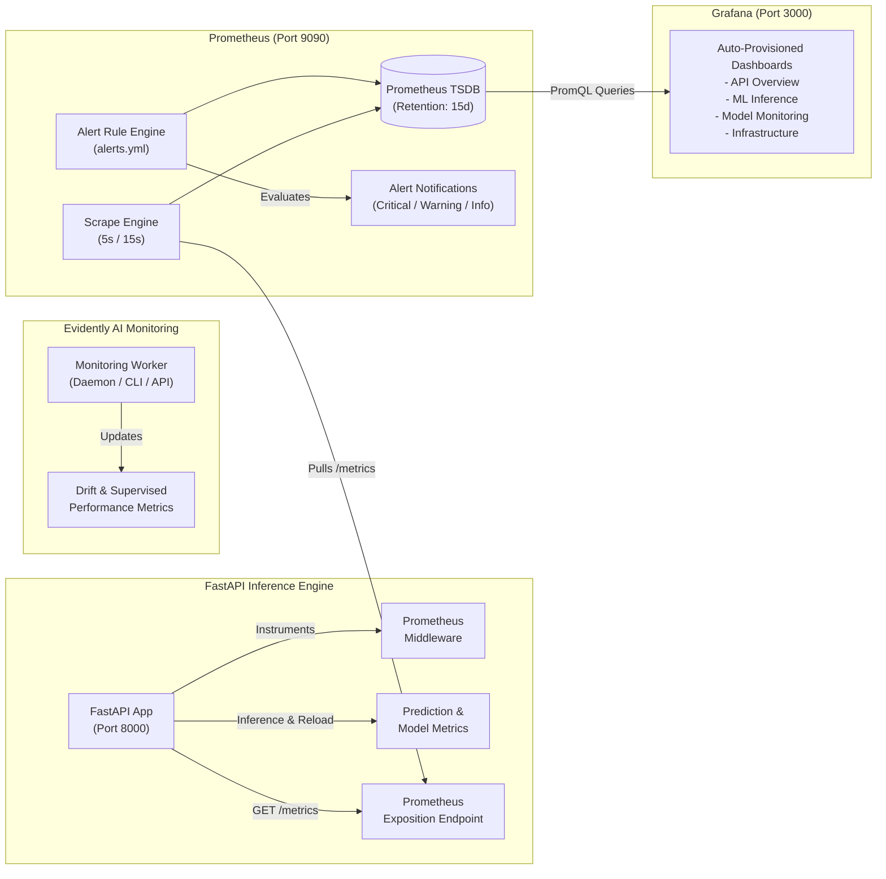

# Phase 6 — Prometheus Observability, Grafana Dashboards & Alert Rules

## 1. Observability Architecture & Design Principles

The Enterprise MLOps Platform features an enterprise-grade observability layer built on Prometheus, Grafana, and native FastAPI instrumentation. The observability architecture is designed around four foundational principles:

1. **Pull-Based Metrics Exposition**: FastAPI exposes standard Prometheus metrics format on `/metrics` with sub-millisecond overhead. Prometheus scrapes targets at configured intervals (5s for API inference, 15s for self-monitoring).
2. **Zero-PII & Low-Cardinality Guarantees**: Metric labels strictly exclude high-cardinality values, customer identifiers, UUIDs, customer features, query parameters, or bearer tokens. Endpoints are normalized to bounded identifiers (`/predict`, `/health`, `/ready`, `/model/info`, `/model/reload`, `/monitoring/status`, `/monitoring/latest`, `/monitoring/run`, `/monitoring/feedback`, `other`).
3. **Decoupled Governance & Alerting**: Prometheus alerts provide automated operational visibility across 3 severity tiers (`critical`, `warning`, `informational`). Alerts notify ML engineers and operators but **never directly trigger automated champion promotion or replacement**.
4. **Declarative Dashboards as Code**: Grafana dashboards and datasources are provisioned automatically from version-controlled YAML and JSON manifests, ensuring instant, reproducible visualization in containerized environments.



---

## 2. Prometheus Metrics Catalog

### 2.1 API Serving Metrics

| Metric Name | Type | Label Dimensions | Description |
| :--- | :--- | :--- | :--- |
| `http_requests_total` | Counter | `method`, `endpoint`, `status_code` | Total HTTP requests processed across normalized routes |
| `http_request_duration_seconds` | Histogram | `method`, `endpoint` | End-to-end request latency distribution (buckets: 5ms to 10s) |
| `http_requests_in_progress` | Gauge | `method`, `endpoint` | Current concurrent requests being processed |
| `http_errors_total` | Counter | `method`, `endpoint`, `status_code` | Total HTTP 4xx client and 5xx server error responses |
| `api_uptime_seconds` | Gauge | None | Current continuous uptime of FastAPI process |
| `api_start_time_seconds` | Gauge | None | Process initialization timestamp (UNIX epoch) |

### 2.2 Model Inference & Prediction Telemetry

| Metric Name | Type | Label Dimensions | Description |
| :--- | :--- | :--- | :--- |
| `model_predictions_total` | Counter | `model_name`, `model_version` | Total model inference operations performed |
| `model_predictions_by_class_total` | Counter | `model_name`, `model_version`, `predicted_class` | Churn vs. No Churn prediction volume |
| `model_prediction_probability` | Histogram | `model_name`, `model_version` | Positive churn probability distribution (buckets: 0.0 to 1.0, including 0.571 threshold) |
| `model_prediction_errors_total` | Counter | `error_type` | Total inference failures (`inference_error`, `validation_error`, `model_not_loaded`) |
| `model_inference_duration_seconds` | Histogram | `model_name`, `model_version` | High-precision Scikit-learn `predict_proba` pipeline latency (buckets: 1ms to 1s) |
| `model_reloads_total` | Counter | `status`, `alias` | Total model reload attempts (`success` or `failure`) |

### 2.3 Model Governance Metrics

| Metric Name | Type | Label Dimensions | Description |
| :--- | :--- | :--- | :--- |
| `model_info` | Gauge | `model_name`, `model_version`, `alias`, `decision_threshold` | Active champion model version metadata (value = 1.0) |
| `model_available` | Gauge | `model_name` | Model readiness gauge (1.0 = active and loaded, 0.0 = offline) |
| `model_last_reload_timestamp_seconds` | Gauge | `model_name` | UNIX timestamp of last successful model reload |
| `model_load_failures_total` | Counter | `model_name`, `alias` | Number of failed model load or candidate verification attempts |

### 2.4 Evidently AI Drift & Monitoring Metrics

| Metric Name | Type | Label Dimensions | Description |
| :--- | :--- | :--- | :--- |
| `monitoring_runs_total` | Counter | `status` | Total monitoring execution cycles (`completed`, `failed`) |
| `monitoring_run_duration_seconds` | Histogram | None | Statistical evaluation cycle execution time (buckets: 0.5s to 60s) |
| `monitoring_drift_detections_total` | Counter | None | Total confirmed dataset drift events (drift share $\ge 30\%$) |
| `monitoring_drift_share` | Gauge | None | Ratio of drifted features over 19 evaluated features |
| `monitoring_data_quality_failures_total` | Counter | None | Total schema, missingness, or enum validation failures |
| `monitoring_prediction_drift_detections_total` | Counter | None | Total output probability or churn rate distribution drift events |
| `monitoring_retraining_recommendations_total` | Counter | `priority`, `trigger_reason` | Total autonomous retraining recommendations generated |
| `monitoring_ground_truth_feedback_total` | Counter | `source` | Total delayed ground-truth outcome records ingested |
| `monitoring_model_roc_auc` | Gauge | None | Verified holdout ROC-AUC on matched ground truth (0 when absent) |
| `monitoring_model_pr_auc` | Gauge | None | Verified holdout PR-AUC on matched ground truth (0 when absent) |
| `monitoring_model_f1` | Gauge | None | Verified holdout F1 score on matched ground truth (0 when absent) |
| `monitoring_model_brier_score` | Gauge | None | Verified holdout Brier calibration score (0 when absent) |

### 2.5 Runtime & Process Metrics

| Metric Name | Type | Label Dimensions | Description |
| :--- | :--- | :--- | :--- |
| `process_cpu_seconds_total` | Counter | None | Cumulative user and system CPU time in seconds |
| `process_resident_memory_bytes` | Gauge | None | Physical memory (RSS) currently used by API container |
| `process_virtual_memory_bytes` | Gauge | None | Virtual memory footprint allocated by process |

---

## 3. Prometheus Alerting Rules & Severity Classification

Alert rules are defined in `monitoring/prometheus/alerts.yml` partitioned across three severity tiers:

```
+-------------------------------------------------------------------------------+
| CRITICAL      | Outage or immediate model disruption requiring on-call action  |
+---------------+---------------------------------------------------------------+
| WARNING       | Latency spikes, feature drift, or data quality degradation   |
+---------------+---------------------------------------------------------------+
| INFORMATIONAL | Normal automated lifecycle directives (retraining trigger)     |
+-------------------------------------------------------------------------------+
```

### Alert Catalog

| Alert Rule Name | Severity | Condition (PromQL) | Duration (`for`) | Operational Action |
| :--- | :--- | :--- | :--- | :--- |
| `ApiServiceUnavailable` | `critical` | `up{job="fastapi-serving"} == 0` | 1m | Restart API container; verify logs for unhandled startup crashes. |
| `ElevatedHttp5xxErrors` | `critical` | `5xx rate / total rate > 0.05` | 2m | Inspect application logs; verify database connectivity and dependency health. |
| `ModelUnavailable` | `critical` | `model_available == 0` | 1m | Trigger emergency model reload from MLflow registry or inspect MLflow container. |
| `ModelReloadFailure` | `critical` | `increase(model_reloads_total{status="failure"}[5m]) > 0` | 1m | Inspect candidate model pipeline signature; previous model was preserved safely. |
| `HighApiRequestLatency` | `warning` | `/predict p95 > 500ms` | 2m | Check CPU throttling; scale API replicas or optimize payload batch sizes. |
| `HighModelInferenceLatency`| `warning` | `predict_proba p95 > 100ms` | 2m | Inspect model feature transformer overhead; profile Scikit-learn steps. |
| `ElevatedPredictionErrors` | `warning` | `rate(model_prediction_errors_total[5m]) > 0.05` | 2m | Review client input payloads for malformed data or schema non-conformity. |
| `DatasetDriftDetected` | `warning` | `monitoring_drift_share >= 0.30` | 5m | Inspect Evidently HTML report in `reports/monitoring/`; audit feature distributions. |
| `DataQualityFailures` | `warning` | `increase(monitoring_data_quality_failures_total[1h]) > 0` | 5m | Verify upstream ingestion pipelines for novel enum values or null surges. |
| `PredictionDriftDetected` | `warning` | `increase(monitoring_prediction_drift_detections_total[1h]) > 0` | 5m | Check output probability calibration against reference baseline (~26.5%). |
| `MonitoringCycleFailed` | `warning` | `increase(monitoring_runs_total{status="failed"}[1h]) > 0` | 2m | Inspect monitoring daemon logs; verify database connections and reference data. |
| `RetrainingRecommendationGenerated` | `informational` | `increase(monitoring_retraining_recommendations_total[1h]) > 0` | 1m | Review trigger reason and trigger metrics in `monitoring.retraining_recommendations`. |

---

## 4. Grafana Dashboards

Grafana dashboards are provisioned automatically from `monitoring/grafana/dashboards/`:

### 4.1 Dashboard A — API Serving Overview (`api_overview.json`)
- **Key Metrics**: API Availability status, Requests in Progress, Total Request Rate (req/s), HTTP 5xx Error Rate (%), HTTP Throughput by Endpoint, Status Code Distribution (200, 422, 500, 503), Request Latency Percentiles (p50, p95, p99).
- **Target Audience**: Infrastructure engineers and SREs monitoring platform health.

### 4.2 Dashboard B — ML Inference & Model Performance (`ml_inference.json`)
- **Key Metrics**: Model Readiness Status, Currently Loaded Champion Model (Name, Version, Alias), Total Predictions Counter, Inference Error Counter, Prediction Volume Rate by Model Version, Churn vs. No Churn Classification Throughput, Raw Pipeline `predict_proba` Latency Percentiles, Model Reload History.
- **Target Audience**: ML engineers and data scientists monitoring inference throughput and model stability.

### 4.3 Dashboard C — Evidently Drift & Quality Monitoring (`model_monitoring.json`)
- **Key Metrics**: Feature Drift Share Radial Gauge (with 20% warning and 30% critical thresholds), Confirmed Drift Events Counter, Data Quality Validation Failures, Ground-Truth Feedback Ingestion Volume, Historical Drift Share Over Time, Retraining Recommendations Emitted by Priority and Reason, Verified Ground-Truth Performance (ROC-AUC, PR-AUC, F1 Score, Brier Calibration).
- **Target Audience**: ML governance teams and model validators monitoring distribution stability.

### 4.4 Dashboard D — Infrastructure & Runtime Observability (`infrastructure.json`)
- **Key Metrics**: Prometheus Target Health, API Resident Memory Footprint (RSS bytes), API Process CPU Utilization (%), API Continuous Uptime, Memory Growth Trend (RSS vs. VMS), Process CPU Cores Usage Rate, Monitoring Cycle Execution Duration.
- **Target Audience**: Platform engineers tracking resource consumption and container sizing.

---

## 5. Docker Deployment & Provisioning

### 5.1 Docker Compose Service Topology
In `docker-compose.yml`, Prometheus and Grafana run alongside the existing services:

```yaml
services:
  postgres:       # Port 5432: Metadata, prediction telemetry, and monitoring audits
  mlflow:         # Port 5000: MLflow experiment tracking and model registry
  api:            # Port 8000: FastAPI model serving engine (exposing /metrics)
  monitoring:     # Worker: Evidently AI drift detection daemon
  prometheus:     # Port 9090: Scrapes API and evaluates alert rules
  grafana:        # Port 3000: Auto-provisioned observability dashboards
```

### 5.2 Starting the Observability Stack
```bash
# Validate compose topology
docker compose config

# Start all services with Prometheus and Grafana
docker compose up -d

# Verify all containers are healthy
docker compose ps
```

### 5.3 Accessing Observability UIs
- **FastAPI Metrics Endpoint**: `http://localhost:8000/metrics`
- **Prometheus Dashboard & Targets**: `http://localhost:9090` (Targets: `http://localhost:9090/targets`)
- **Prometheus Alerts Console**: `http://localhost:9090/alerts`
- **Grafana Console**: `http://localhost:3000` (Default credentials: `admin` / `admin` configured via `.env`)

---

## 6. Security & Operational Hardening

1. **Low-Cardinality Metrics**: No customer PII, tenant identifiers, or request UUIDs are included in Prometheus metric labels.
2. **Credential Management**: Grafana administrative credentials (`GF_SECURITY_ADMIN_USER`, `GF_SECURITY_ADMIN_PASSWORD`) are supplied through environment variables and never committed to source control.
3. **Internal Network Isolation**: Prometheus scrapes services over the internal bridge network (`mlops_network`).
4. **Read-Only Mounts**: Configuration files (`prometheus.yml`, `alerts.yml`, Grafana provisioning manifests) are mounted `:ro` inside containers.
5. **Human-in-the-Loop Safeguard**: Drift detection alerts notify operators and record retraining directives; they **never trigger automated champion model replacement**.
